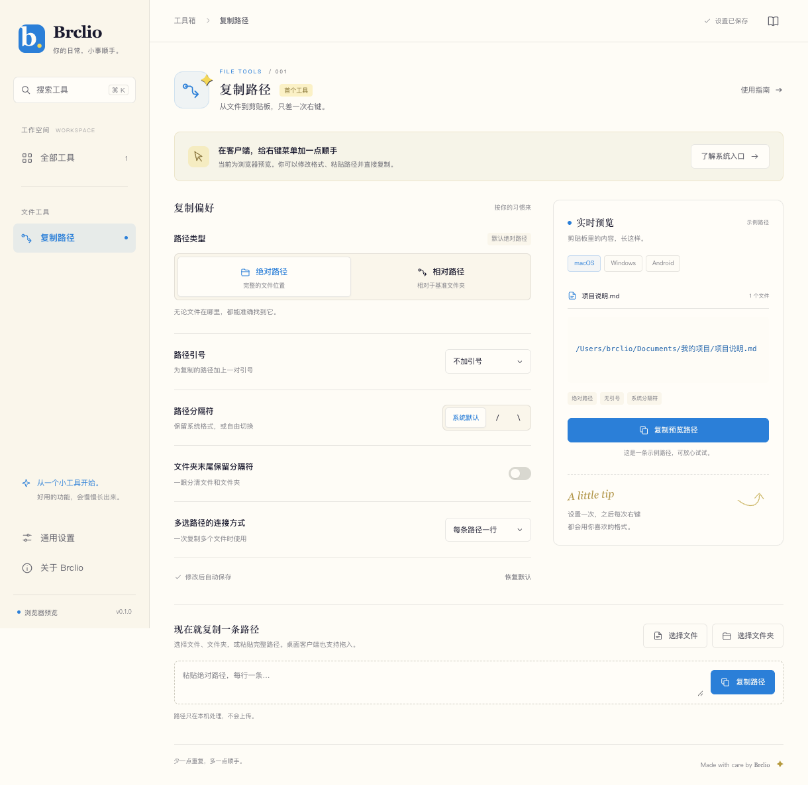

# Brclio

让日常的小事，变得顺手一点。Windows、macOS、Android 共用界面的本地工具软件，首个功能是**复制文件和文件夹路径**。

[下载安装包](https://github.com/Brclio/Brclio/releases/latest) · [发布记录](https://github.com/Brclio/Brclio/releases)



## 主要功能（v0.1.15）

- 桌面复制快捷键：在前台 Finder／资源管理器中选中文件或文件夹后，按 macOS `Option+P`、Windows `Alt+P` 直接复制所选路径，沿用保存的格式。可在“通用设置 → 复制所选路径”中修改组合键或恢复默认；发生占用时保留原组合并提示。

- Windows 资源管理器右键菜单：Windows 11 使用第一层“复制路径 · Brclio”，支持文件、文件夹、多选及文件夹空白处；Windows 10 保留经典菜单入口。
- macOS Finder 第一层右键菜单“复制路径 · Brclio”：支持文件、文件夹、多选及文件夹空白处；软件关闭时也可调用。
- macOS Finder 顶部工具栏复制图标：点击后选择“复制路径 · Brclio”，沿用已保存的格式设置，支持多选。
- Android 系统文件 / 文件夹选择器、文件管理器分享入口和应用内长按复制。
- 默认绝对路径、不带引号；可配置相对路径及基准文件夹、文本引号、分隔符、目录末尾分隔符和多选连接方式。
- 实时输出预览、桌面拖入文件、手动粘贴多条路径、本机自动保存偏好。
- 在线检查 GitHub 新版本、下载安装包、显示进度、SHA-256 校验、进入系统安装流程。
- 网页、Windows、macOS 和 Android 共用账号功能：账号名、邮箱、邮件验证码和密码注册；账号或邮箱加密码登录；Google 注册及登录。
- 登录后可手动上传、读取和应用复制格式偏好；每位用户的数据保存在现有私有 GitHub 数据仓库的独立目录。复制路径与本机偏好继续可离线使用，无需登录。

设置 → 版本更新 → 检查新版本。更新仅从本仓库的稳定版 Release 获取，用户点击下载后才下载；校验未通过的安装包不会进入安装流程。

v0.1.9 加入内置更新代理：检测到系统代理时优先沿用系统网络；可以在版本更新和关于窗口临时关闭，完全退出后重新启动默认恢复开启。管理员可在综合客户端后台维护订阅，全局配置保存在私有程序资料仓库 `BrclioData/BrclioData`，详见[更新代理与后台说明](docs/update-proxy.md)。

v0.1.14 支持断点续传：网络中断后保留已下载部分，自动重试、手动继续及重启后下载同一安装包都会恢复匹配进度。首次失败后最多自动重试 10 次；完成后仍校验整个安装包的 SHA-256。

v0.1.15 移除下载的 10 分钟总时限：有数据持续到达就继续下载；单次连接或读取空闲超时仍触发重试，最多自动重试 10 次。

Brclio 介绍与正式版本下载主页位于 [tools.brclio.com](https://tools.brclio.com)，用户账号位于 [/account](https://tools.brclio.com/account)，管理后台位于 [/admin](https://tools.brclio.com/admin)。`cloudflare/` 提供单一 Worker 的账号与客户端更新服务；服务端凭据留在正确 Cloudflare 账号的环境配置中。账号、昵称、个人设置与用户所属的各程序数据存入 `BrclioData/BrclioUserData`，全局代理配置等程序资料存入 `BrclioData/BrclioData`，详见[客户端服务部署说明](docs/client-services.md)。后端上线、新客户端安装包发布和已安装客户端升级分别验证。

账号注册支持 3–32 位账号名、邮箱验证及 8–128 位密码，验证码 10 分钟有效。Google 已验证邮箱会自动绑定同邮箱的现有账号；首次通过 Google 注册后，可在账号设置中完善昵称、账号和密码。Google 登录在系统浏览器中完成，客户端仅在网页确认授权后取得自己的会话。共享私库目标为 `BrclioData/BrclioUserData`，保持 `users/<用户ID>/profile.json`、`credentials.json` 的统一身份，复制偏好写入 `apps/brclio/data.json`，小程序数据写入 `apps/miniapp/data.json`。旧 `data.json` 保留并仅在新路径缺失时回退读取。按产品所有者要求，账号密码在 `credentials.json` 的 `passwordPlaintext` 字段明文保存，同时保留加盐哈希用于验证；仓库及 Git 历史的读者可直接读取密码。历史账号无法由旧哈希还原密码，将在成功密码登录或设置密码时补写。验证码和会话标识保存摘要。服务端通过 GitHub App 私钥换取单仓库短期安装令牌，不使用个人 Token；App 私钥、安装令牌、邮件和 Google 密钥不进入仓库或安装包。接入规范和可复制 Skill 见 [共享用户数据文档](docs/shared-user-data/README.md)。App 配置、真实数据迁移和生产切换分别验收，不从本地实现推断已上线。

复制快捷键需要 Brclio 正在运行，窗口最小化也可用；macOS 关闭窗口后仍可用，退出软件后停止，Windows 关闭最后一个窗口会退出软件。macOS 首次使用可能请求允许 Brclio 控制 Finder，可在“系统设置 → 隐私与安全性 → 自动化”中管理。Windows 11 通过资源管理器的活动视图和文件列表焦点识别当前标签页；无法确认时，请先点击该页中已选中的文件或文件夹后重试，也可将目标页移到独立窗口，避免复制后台页的选区。未选中有效项目、前台应用不符或无法确认选区时保留原剪贴板并提示。浏览器预览与 Android 不支持此全局快捷键。

## 下载与安装

| 平台 | 安装包 | 安装方式 |
| --- | --- | --- |
| Windows x64 | `Brclio-版本-windows-x64.exe` | 运行安装向导，可选择安装目录 |
| macOS Apple Silicon | `Brclio-版本-mac-arm64.dmg` | 打开 DMG，将 Brclio 拖入 Applications |
| macOS Intel | `Brclio-版本-mac-x64.dmg` | 打开 DMG，将 Brclio 拖入 Applications |
| Android 8.0+ | `Brclio-版本-android.apk` | 允许当前来源安装应用，交给系统安装器 |

macOS 从 v0.1.1 起使用完整的 ad-hoc 应用签名，修复 v0.1.0 的“应用已损坏”打包缺陷；目前尚无 Developer ID 签名和 Apple 公证。首次打开可能提示无法验证开发者：先尝试打开，再到 **系统设置 → 隐私与安全性 → 仍要打开**，确认“打开”。这是对 Brclio 单个应用的允许，详见 [Apple 官方说明](https://support.apple.com/zh-cn/102445)。如果仍提示“已损坏”，请确认已替换为 v0.1.1 或更新版本。

从 v0.1.3 起，在设置中检查版本后点击“下载并安装更新”，macOS 和 Windows 会校验安装包、覆盖当前安装目录并自动打开新版，保留偏好和右键菜单。只有新版界面完成初始化、版本与进程确认成功后才清理旧版备份；启动失败会尝试恢复并重新打开旧版。安装目录不可写时会在退出软件前报错。

v0.1.2 及更早版本还没有自动覆盖安装能力，首次升级到 v0.1.3 需退出旧版后手动安装一次，后续版本即可使用新流程。Windows 尚未配置 Authenticode 发行签名。macOS 尚未公证，系统可能要求允许本应用打开。Android APK 使用项目固定的私有发布密钥签名，更新需沿用同一密钥，并由用户确认系统安装；安装完成尝试自动打开，受系统限制时点击安装器的“打开”。

右键入口默认关闭。在软件的“复制路径”页面点击“启用右键菜单”，可随时停用。macOS 请先将 v0.1.2 或更新安装版放入 Applications 并打开；如果 Finder 菜单未显示，在系统设置中搜索“扩展”，允许 Brclio 的 Finder 扩展（部分系统版本归在“文件提供程序”中），再返回软件重新启用。移动了桌面软件的位置后，可在软件中修复入口。新的 Windows 11 安装包内含原生扩展和已签名的身份包，无需购买证书或开启开发者模式。首次启用及签名证书变化时，会通过标准管理员授权将 Brclio 专用公钥加入 TrustedPeople，以满足 Windows 部署服务要求。Windows 10 的经典入口仍仅处理单个项目。

macOS 从 v0.1.2 起改用 Finder Sync 第一层菜单。新入口启用成功或停用集成时，会自动移除旧版由 Brclio 安装且带归属标记的 `Brclio Copy Path.workflow` 服务；未带该标记的同名工作流和其它服务会保留。Finder 的部分特殊、虚拟或云盘视图可能不显示扩展菜单，多个 Finder 扩展覆盖同一目录时也可能冲突；具体以当前系统中的实际菜单为准，详见[桌面端说明](docs/desktop.md)。

## 路径规则

绝对路径示例：`C:\Users\Brclio\Documents\项目\说明.md`、`/Users/brclio/Documents/项目/说明.md`。

选择相对路径后，以用户指定的绝对基准文件夹计算。例如基准为 `C:\Projects`，文件为 `C:\Projects\demo\README.md`，结果为 `demo\README.md`。跨磁盘、跨网络共享或无法确定真实路径的 URI 会明确报错，不会静默输出错误的相对路径。

Android 的云盘和部分文件管理器仅提供 `content://...`。Brclio 原样保留并标记真实 URI；已知的主共享存储文档才映射为 `/storage/emulated/0/...`。Android 无跨所有文件管理器的统一右键扩展，所以提供选择、分享和应用内长按入口。

引号设置只包装路径文本，不是终端命令的转义工具。复制路径不读取文件内容，不上传文件，也不需要登录账号。

## 本地运行

需要 Node.js 22 或更新版本。

```sh
npm ci
npm start
```

浏览器预览（浏览器不允许读取本机文件的完整路径，可粘贴路径测试）：

```sh
npm run dev
```

打开 `http://127.0.0.1:4173`。`web/index.html` 也可在执行 `npm run sync` 后直接打开，全部界面资源均在本地。该静态预览用于验证路径工具和本机偏好；浏览器账号接口需通过同源 Worker 提供，账号部署配置见[客户端服务说明](docs/client-services.md#用户账号配置)。

## 验证与构建

```sh
npm test
npm run test:ui       # 先启动 npm run dev；默认使用本机 Chrome
npm run test:hosts    # 启动独立临时服务，验证跨端桥接协议
npm run test:updates  # 更新下载、校验失败重试、进度与安装入口验证
npm run test:desktop  # 真实 Electron / 剪贴板 / 重启验证，自动还原剪贴板
npm run build:mac
npm run build:win
```

浏览器验证可通过 `BRCLIO_CHROME` 指定 Chrome / Chromium 可执行文件。桌面原生烟测会使用独立临时用户目录，不安装主机右键菜单。

Android 构建需要 JDK 17、Android SDK 35，详见 [Android 文档](docs/android.md)。Release 需显式配置签名，缺少签名时构建会失败；不把 debug APK 标为正式版。

## 项目结构

```text
core/       零依赖共享路径格式引擎
web/        Brclio 品牌界面、工具导航、偏好和平台桥接
desktop/   Electron 客户端、系统菜单、设置和在线更新
android/    Kotlin 原生入口、离线 WebView、系统选择器与安装器
cloudflare/ 账号、验证码邮件、Google 登录、网页和客户端服务
scripts/    资源同步、验证、校验清单
.github/    持续集成与三端发布流程
```

各平台适配层与路径引擎分离，后续工具可以独立增加。本机配置和更新状态保存在当前设备。客户端启动及用户打开账号界面时读取会话；注册、登录、验证码邮件、Google 授权和手动偏好同步使用账号服务，版本检查与下载使用更新服务。文件内容、实际文件路径、相对路径基准文件夹及设备专属设置不会随偏好同步上传。

## 设计与署名

界面从 [Brclio Design System](https://github.com/Brclio/brclio-design-system) 的 App 模板改造，使用暖色背景、品牌蓝 / 黄 / 红、衬线标题和紧凑的工具布局。设计素材及对应衍生设计遵循 **CC BY-NC-SA 4.0**。

软件图标统一采用品牌素材库中的 Brclio 组织标志，覆盖 macOS、Windows、Android 和共享界面。来源、校验摘要与重新生成方法见 [图标说明](resources/README.md)。

© 2026 Brclio · 黄家宝。写代码，教编程，做产品。
